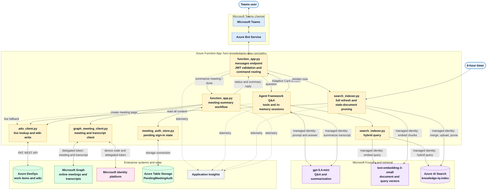
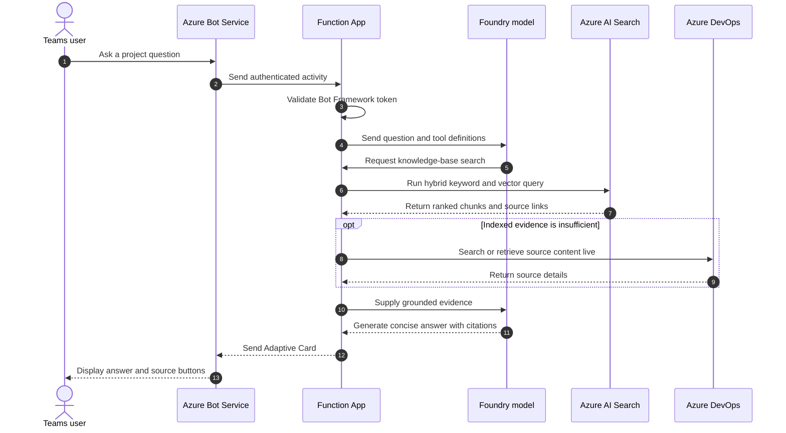
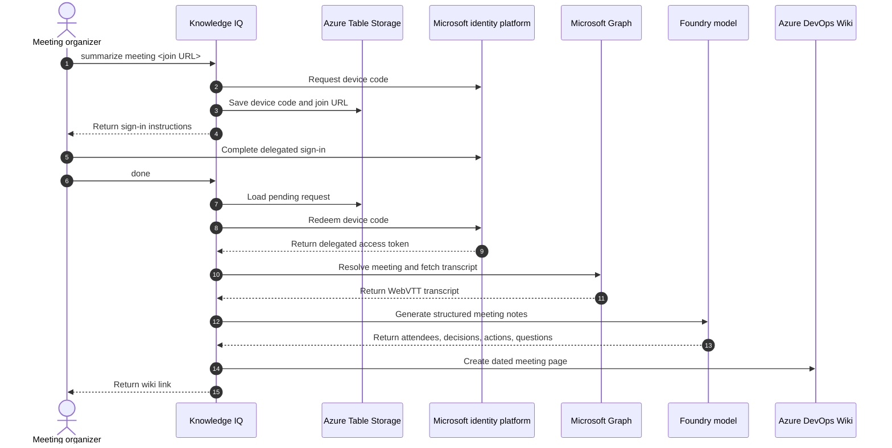
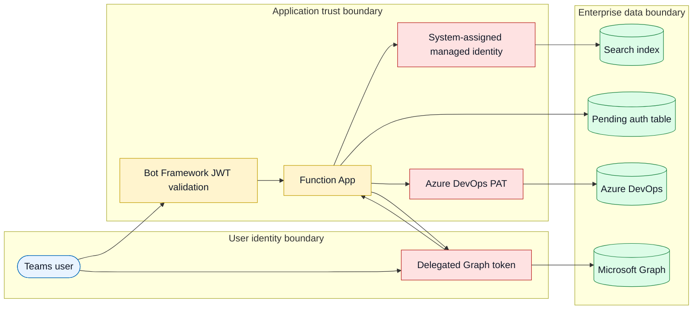
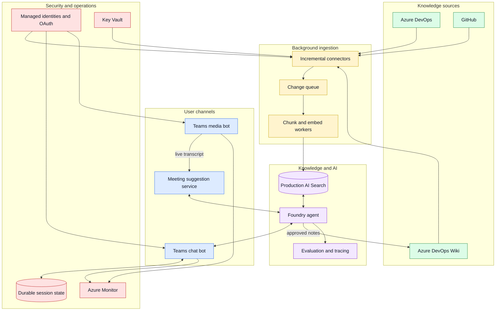

## Executive overview

Knowledge IQ is a Microsoft Teams assistant that turns Azure DevOps content into
accessible, cited answers and converts completed Teams meeting transcripts into
structured wiki notes.

The current solution is a modular Python application deployed as one Azure Function
App. It integrates Teams, Azure Bot Service, Microsoft Foundry, Azure AI Search,
Azure DevOps, Microsoft Graph, and Azure Storage. This design keeps the pilot small
while separating the code by responsibility so individual workloads can move to
dedicated services as demand grows.

### Business value

* Reduces time spent searching across work items and wiki pages
* Answers in Teams with links to the supporting source material
* Converts meeting transcripts into reusable decisions and action items
* Establishes a shared retrieval layer for future GitHub content and live meeting
  assistance

### Delivery snapshot

| Capability | Status | Current experience |
|------------|--------|--------------------|
| Azure DevOps Q&A | Delivered | Hybrid search across work items and wiki pages, with live API fallback |
| Source citations | Delivered | Adaptive Card responses link to source work items and wiki pages |
| Knowledge refresh | Delivered | Full refresh every six hours and on-demand refresh with `reindex now` |
| Meeting summary | Pilot | User-authorized transcript retrieval, AI summary, and wiki write-back |
| GitHub knowledge | Planned | Issues, pull requests, and code are not indexed today |
| Live meeting suggestions | Planned | Requires a real-time Teams media bot and proactive meeting messages |

## Architecture principles

* Ground every answer in approved enterprise content and return source links.
* Use managed identity for Azure service-to-service access where supported.
* Keep source adapters, retrieval, orchestration, and channel handling modular.
* Start with post-meeting processing before introducing real-time media complexity.
* Prefer a small operational footprint during validation, then separate workloads
  when scale, latency, or reliability requires it.

## Current architecture

The deployed system uses one Function App as the orchestration and compute boundary.
The diagram maps the deployed Python modules and their actual runtime dependencies.
Q&A, indexing, and meeting summarization share infrastructure but follow separate
processing paths.

### Diagram color key

| Color | Meaning |
|-------|---------|
| Blue | User and Teams channel |
| Amber | Application runtime and transient processing state |
| Purple | AI models and retrieval services |
| Green | Enterprise data and durable application state |
| Pink | Identity and delegated authorization |
| Gray | Monitoring and telemetry |

## Q&A processing flow

The indexed knowledge base is the preferred retrieval path. Direct Azure DevOps API
calls provide a fallback when indexed results are insufficient and provide detailed
lookups for a known work item ID or wiki path.

### Retrieval and indexing

1. A timer trigger runs every six hours, or a user invokes `reindex now`.
2. The indexer reads all Azure DevOps work items and wiki pages.
3. Content is split into chunks of approximately 3,000 characters.
4. `text-embedding-3-small` generates a vector for each chunk.
5. Chunks are merged into `knowledge-iq-index`; stale chunks are removed.
6. At query time, keyword and vector results are ranked together.

This is a full-source refresh, not a delta sync. It is appropriate for the current
pilot volume but will become slower and more expensive as content grows.

## Meeting summary flow

Meeting summarization is asynchronous and post-meeting. The bot does not join the
call or process live audio. The meeting organizer authorizes transcript access by
using the device code flow.

The flow currently works only when the signed-in user organized the meeting,
transcription was enabled, and tenant Conditional Access policy permits the device
code flow. End-to-end validation with a production meeting remains a pilot exit
criterion.

## Component responsibilities

| Component | Responsibility | Authentication |
|-----------|----------------|----------------|
| Microsoft Teams | User interaction in personal, team, and group chat | Teams identity |
| Azure Bot Service | Teams channel registration and Bot Framework message relay | Single-tenant bot registration |
| Azure Function App | Request validation, command routing, agent tools, indexing, and summarization | Managed identity and app credentials |
| Microsoft Foundry | Chat completion and transcript summarization | Function managed identity |
| Azure AI Search | Hybrid retrieval over indexed Azure DevOps content | Function managed identity |
| Azure DevOps | Work item and wiki read access; meeting-note write-back | Shared project PAT |
| Microsoft Graph | Organizer meeting lookup and transcript retrieval | Delegated user token |
| Azure Table Storage | Pending meeting authorization state | Function storage connection |

## Security and data boundaries

### Security posture

* Inbound Bot Framework activities are validated before processing.
* Managed identity avoids keys for Foundry and Azure AI Search.
* Model calls disable provider-side conversation storage.
* Meeting access is delegated to the organizer and limited to transcript read scope.
* Pending device codes are stored in Azure Table Storage and deleted after token
  redemption or terminal failure.
* The Azure DevOps PAT was rotated after its previous exposure. It remains the main
    credential risk because one shared secret serves read and write paths.
* Meeting transcripts and summaries can contain sensitive information. Retention,
  access control, and consent requirements must be agreed before production rollout.

## Deployment view

All current resources are deployed in `eastus2` within resource group
`rg-knowledge-iq-agent-dev-005cbe47`.

| Azure resource | Purpose | Current tier or mode |
|----------------|---------|----------------------|
| `knowledgeiq-relay-bot` | Teams channel and bot registration | Single tenant |
| `func-knowledgeiq-relay-cpvzgdnu` | Bot, agent tools, indexer, and meeting workflow | Linux Consumption |
| `EastUS2LinuxDynamicPlan` | Function hosting plan | Consumption |
| `stkiqrelaycpvzgdnu` | Function runtime storage and pending auth table | Storage account |
| `search-knowledgeiq-cpvzgdnu` | Hybrid knowledge index | Free tier |
| `cog-3y7mapyaibvjm` | Foundry account and model deployments | `gpt-5.4-mini`, `text-embedding-3-small` |
| Application Insights | Function telemetry | Runtime monitoring |

## Constraints and production risks

| Priority | Constraint or risk | Impact | Recommended action |
|----------|--------------------|--------|--------------------|
| High | Azure DevOps uses a shared PAT | Broad credential exposure affects read and write operations | Store the rotated secret in Key Vault, then replace it with scoped OAuth or workload identity |
| High | Q&A sessions are held in Function memory | Context is lost on restart or scale-out | Move session state to Cosmos DB or another durable distributed store |
| High | Meeting workflow is not validated end to end in production | Pilot capability may fail under real tenant policies or transcript conditions | Run a scripted organizer meeting test and capture operational evidence |
| Medium | Search runs on the Free tier | No SLA and limited capacity | Establish volume and availability targets, then select a production tier |
| Medium | Every refresh reads and embeds all content | Refresh cost and duration grow with content volume | Add changed-date and ETag-based delta synchronization |
| Medium | Device code flow may be blocked by Conditional Access | Meeting summaries are unavailable in restricted tenants | Validate tenant policy and design an approved delegated or application flow |
| Medium | One Function hosts interactive and scheduled workloads | Reindexing can contend with chat traffic | Separate indexing when measured latency or scale requires it |
| Low | GitHub content is absent | Answers cover only Azure DevOps sources | Add a least-privilege GitHub App connector |

## Target architecture

The target separates interactive chat, background ingestion, and real-time meeting
media. Shared retrieval and governance services support every channel.

## Delivery roadmap

| Stage | Outcome | Exit criteria |
|-------|---------|---------------|
| 1. Harden the pilot | Secure and reliable current capabilities | PAT rotated, secrets externalized, durable sessions, meeting test passed, alerting enabled |
| 2. Improve knowledge operations | Scalable and measurable retrieval | Delta indexing, production Search tier, representative Q&A evaluation suite |
| 3. Expand source coverage | Unified engineering knowledge | GitHub issues, pull requests, and selected code indexed with source filters |
| 4. Enable live assistance | Timely suggestions during meetings | Media bot validated, consent model approved, relevance thresholds measured, suggest-only rollout completed |

## Copilot Studio alternative assessment

Copilot Studio is a viable implementation option, particularly when low-code
authoring, rapid Microsoft 365 distribution, and business-maker ownership are the
primary requirements. We selected a code-first implementation because the pilot's
hardest requirements were custom integration and orchestration rather than
conversation authoring.

> [!IMPORTANT]
> The current solution runs Microsoft Agent Framework inside Azure Functions and
> calls models through a Microsoft Foundry project endpoint. It is not currently a
> persisted prompt agent or hosted agent in Microsoft Foundry Agent Service. A
> future migration to a Foundry hosted agent could retain the Python orchestration
> while moving hosting, scaling, identity, sessions, and agent observability to the
> managed service.

### Advantages of the selected implementation

The selected approach has a clear advantage where Knowledge IQ differs from a
standard conversational agent: custom retrieval and cross-service orchestration.

| Advantage for Knowledge IQ | How the current solution delivers it | Copilot Studio implication | Why it mattered to the decision |
|----------------------------|--------------------------------------|----------------------------|---------------------------------|
| Direct control of retrieval quality | Python controls Azure DevOps extraction, chunk size, embeddings, hybrid Search queries, result count, stale-document removal, and source metadata | The existing retrieval service would need to be retained and exposed through a connector, flow, API, or tool | Retrieval behavior is a core product capability rather than a replaceable channel feature |
| One runtime for custom workflows | The Function App contains Q&A tools, indexing, Graph transcript retrieval, summarization, Wiki write-back, retries, and response rendering | Copilot Studio would orchestrate several of these operations but would still depend on an external custom backend | The pilot avoids operating both a Copilot Studio solution and a separate integration application |
| Explicit and testable control flow | Source code defines indexed search first, live Azure DevOps fallback second, no-answer behavior, retries, and error handling | Generative orchestration is configuration-driven; reproducing the exact fallback contract requires additional topics, tools, or flows | Predictable grounding and failure behavior are required for trusted engineering answers |
| Custom delegated meeting authorization | The application owns the device-code exchange, durable pending state, delegated Graph token, transcript conversion, and cleanup | This sequence would require custom connectors, flows, or an external API and would remain application-specific | The meeting workflow could not be implemented only by selecting built-in knowledge sources |
| Exact citation and Teams response contract | The agent requires source URLs and the bot renders deterministic Adaptive Card source buttons | Copilot Studio supports citations and cards, but customized generative responses require explicit citation rendering | Human-visible evidence is a permanent architecture principle for the solution |
| Unified engineering lifecycle | Agent instructions, tools, clients, retry policies, and card behavior are versioned and reviewed with the Python application | Power Platform solutions provide ALM, but custom backend code and low-code configuration would have separate release surfaces | One code review and deployment path reduces coordination risk for the current engineering-owned pilot |
| Model and hosting portability | Agent Framework keeps orchestration in application code while Foundry supplies the model endpoint | Moving orchestration into Copilot Studio increases dependence on its harness, topics, connector model, and billing construct | The team can change models or move the same code to Foundry Agent Service without rewriting the business workflow |
| Reuse of existing implementation assets | The Azure DevOps client, Search indexer, Graph client, retry helper, and Adaptive Card renderer are composed directly | Each asset would need to be wrapped, replaced, or invoked across the Copilot Studio boundary | Reuse shortened pilot delivery and avoided migration work that did not add user value |
| Application-level troubleshooting | Application Insights logs capture Python exceptions, API failures, retries, and indexing outcomes at the point of execution | Copilot Studio offers platform analytics, but failures in retained custom services still require separate telemetry | A single diagnostic path is valuable while integration behavior is still being validated |

The advantage is therefore not that Copilot Studio is incapable. The current
implementation avoids an additional orchestration layer around custom services that
the solution must operate in either design.

### Broader platform comparison

| Decision area | Current code-first implementation | Copilot Studio implementation | Review implication |
|---------------|-----------------------------------|-------------------------------|--------------------|
| Primary authoring model | Python, Agent Framework, and source-controlled infrastructure | Graphical low-code authoring with agents, topics, tools, workflows, and agent flows | Copilot Studio reduces specialist development effort; code provides finer implementation control |
| Teams delivery | Azure Bot Service, Teams app manifest, and a custom Function endpoint | Managed publishing to Teams, Microsoft Copilot, and the organizational app catalog | Copilot Studio provides the simpler channel and distribution path |
| Knowledge retrieval | Custom Azure DevOps ingestion, chunking, embeddings, hybrid Azure AI Search, citations, and live API fallback | Built-in knowledge is strongest for SharePoint, Dataverse, uploaded files, websites, and Microsoft Copilot connectors; other retrieval paths require connectors, tools, flows, or custom data patterns | The current Azure DevOps and Azure AI Search strategy maps more directly to code than to built-in Copilot Studio knowledge |
| Tool orchestration | Explicit Python tools, prompts, fallback rules, retries, and error handling | Platform orchestration selects knowledge, topics, connectors, and flows from configured descriptions and instructions | Code improves determinism and debuggability; Copilot Studio accelerates standard business actions |
| Meeting workflow | Custom device-code OAuth, Microsoft Graph transcript retrieval, durable pending state, model summarization, and Azure DevOps Wiki write-back | Topics and flows can coordinate supported connectors, but this delegated Graph sequence and Azure DevOps write-back would still require custom connectors, flows, or an external API | Copilot Studio would not eliminate the custom integration boundary |
| Response experience | Adaptive Cards and source buttons are constructed directly from model output | Native messages and cards are easier to author, but customized generative answers require explicit citation rendering | Both can meet the experience; code gives exact control over card and citation behavior |
| Identity and data access | Managed identity for Azure services, delegated Graph token, and a scoped Azure DevOps credential | Microsoft Entra user authentication, connection references, connector policies, environments, and Power Platform data-loss prevention controls | Copilot Studio provides stronger low-code governance; custom identities still require careful connector design |
| Application lifecycle | Git review, Python tests, Azure deployment, and direct dependency management | Power Platform solutions, environments, pipelines, sharing, and administrative inventory | The better fit depends on whether engineering or Power Platform teams own the product |
| Observability and quality | Application Insights plus application-defined logs and future evaluation work | Built-in analytics and evaluations, with platform-level administration | Copilot Studio starts with more product analytics; code requires deliberate telemetry and evaluation investment |
| Cost model | Azure Functions, Foundry model usage, Azure AI Search, Storage, Bot Service, and monitoring consumption | Copilot Studio licensing or Copilot Credits, plus premium connectors and any retained Azure services | A measured workload estimate is required; neither option is inherently lower cost |

The tradeoff is explicit: we accepted more code, infrastructure, testing, security,
and operational ownership in exchange for control over the parts that differentiate
this solution.

### Where Copilot Studio would be the better choice

Copilot Studio should be preferred when most requirements use supported Microsoft
365 or Power Platform knowledge and connectors, business makers must own frequent
conversation changes, managed Teams and Microsoft Copilot publishing is a priority,
or platform analytics and governance outweigh low-level orchestration control.

It also remains a valid front end for a hybrid architecture. The current retrieval
and meeting capabilities could be exposed as secured APIs, connectors, or MCP tools,
while Copilot Studio owns conversation authoring and Microsoft 365 distribution.
This option becomes attractive when reuse by multiple agents provides enough value
to justify the additional platform boundary.

### Revisit criteria

Reassess the choice when one or more of these conditions becomes true:

* Most knowledge moves to SharePoint, Dataverse, or supported Microsoft Copilot
  connectors
* A Power Platform team assumes product ownership and needs low-code release cycles
* The organization standardizes agent governance and chargeback on Copilot Studio
* Teams and Microsoft Copilot distribution effort becomes a larger cost than custom
  orchestration
* The custom backend is exposed as reusable APIs or MCP tools, reducing migration
  effort
* A workload-based cost estimate shows a material Copilot Studio advantage

### Decision statement for the review board

We did not select the code-first approach because Copilot Studio lacks agent or
Teams capabilities. We selected it because the pilot's differentiating behavior is
implemented in custom Azure DevOps retrieval and a delegated Microsoft Graph meeting
workflow. Implementing those capabilities in Copilot Studio would still require
custom connectors, flows, or hosted APIs, while adding a second application lifecycle.
The decision should be revisited if the product shifts toward standard Microsoft 365
knowledge, low-code ownership, or broad Copilot distribution.

### Product references

* [Copilot Studio overview](https://learn.microsoft.com/microsoft-copilot-studio/fundamentals-what-is-copilot-studio)
* [Copilot Studio knowledge sources](https://learn.microsoft.com/microsoft-copilot-studio/knowledge-copilot-studio)
* [Publish Copilot Studio agents to Teams and Microsoft Copilot](https://learn.microsoft.com/microsoft-copilot-studio/publication-add-bot-to-microsoft-teams)
* [Copilot Studio licensing and plans](https://learn.microsoft.com/microsoft-copilot-studio/requirements-licensing-subscriptions)
* [Microsoft Foundry Agent Service overview](https://learn.microsoft.com/azure/foundry/agents/overview)

## Key architecture decisions

| Decision | Rationale | Revisit when |
|----------|-----------|--------------|
| Modular monolith on Azure Functions | Minimizes pilot cost and operational overhead | Indexing affects chat latency or workloads need independent scaling |
| Hybrid retrieval before live API fallback | Improves semantic recall while retaining precise source lookup | Evaluation shows another retrieval strategy performs better |
| Post-meeting transcripts before live audio | Delivers summary value without a media bot service | Live suggestions receive funding and governance approval |
| Delegated meeting access | Preserves user context and avoids broad tenant-wide access | Organization-wide meeting automation is approved |
| Human-visible citations | Supports trust, verification, and source navigation | This remains a permanent product requirement |
| Code-first Agent Framework with Foundry models over Copilot Studio | Keeps custom retrieval, Graph orchestration, citations, and error handling in one source-controlled runtime | Standard Microsoft 365 knowledge, low-code ownership, or managed Copilot distribution becomes the dominant requirement |

## Presentation summary

Knowledge IQ has a working Azure DevOps Q&A foundation and a pilot meeting-summary
workflow. The architecture deliberately favors low operational cost and rapid
validation. Production readiness depends on credential remediation, durable state,
measured retrieval quality, and a completed real-meeting test. GitHub ingestion and
live meeting suggestions are clear next-stage capabilities, not features of the
current deployment.